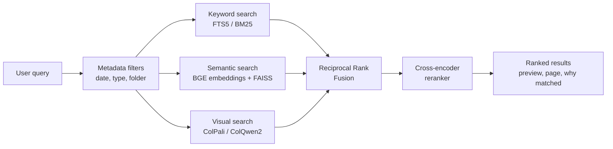
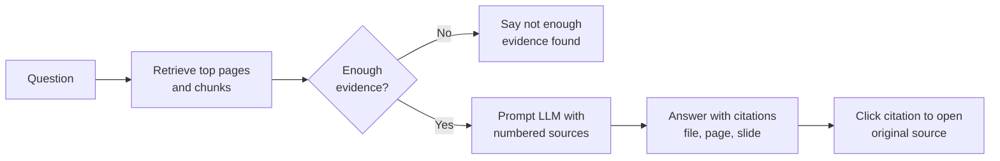
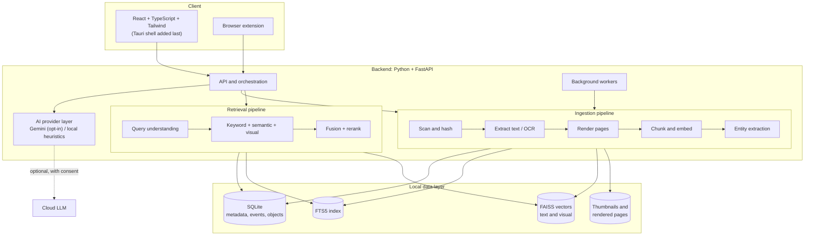

# Recall

**A private, multimodal personal memory and knowledge system.**

> You should not have to remember where you saved something.
> You should only have to remember something about it.

Recall indexes the folders you choose (PDFs, slides, documents, screenshots, notes) and lets you
**find** anything by meaning, words or visual content, **revisit** it on a memory calendar,
**connect** it in a knowledge map, and **ask questions** or **study** from it, with every answer
traced back to the original file and page.

*Recall is the working project name. It should be reviewed before any public release because other
products use similar names.*

---

## Table of contents

1. [The problem](#1-the-problem)
2. [Features](#2-features)
3. [User interface](#3-user-interface)
4. [How it works](#4-how-it-works)
5. [Architecture](#5-architecture)
6. [Tech stack](#6-tech-stack)
7. [Data model](#7-data-model)
8. [Project structure](#8-project-structure)
9. [Getting started](#9-getting-started)
10. [API overview](#10-api-overview)
11. [Evaluation](#11-evaluation)
12. [Privacy and security](#12-privacy-and-security)
13. [Scope, limitations and risks](#13-scope-limitations-and-risks)
14. [Status checklist](#14-status-checklist)

---

## 1. The problem

Useful information ends up scattered across folders, apps and formats: lecture PDFs, screenshots of
diagrams, slide decks, handwritten notes, saved webpages and code references. People usually
remember **what it was about** or **what it looked like**, not the filename or folder.

Typical searches that filename search and plain text search handle badly:

- "Find the screenshot where I studied Dijkstra's algorithm. It had a weighted graph."
- "Show me the neural network diagram with max pooling."
- "I remember a chart comparing model accuracy and computation, but not which paper it was in."
- "What did I save about transformers, and how does it relate to my notes on attention?"

Recall solves this by indexing both the **text** and the **visual content** of selected files, then
retrieving with several complementary methods.

## 2. Features

| # | Feature | What it does |
|---|---|---|
| 1 | **Natural memory search** | Keyword, semantic and visual search with filters (date, type, folder, tag). Results show a preview, the page number and *why* they matched. |
| 2 | **Visual intelligence** | Finds diagrams, charts, tables and layouts from their appearance, even when the page text never mentions them. |
| 3 | **Memory calendar and timeline** | Day / week / month / year views, a visual memory wall, "On This Day", and recaps built only from recorded data. |
| 4 | **Ask My Memory** | Chat that answers from your own files with clickable citations. Says "not enough evidence" when the files don't contain the answer. |
| 5 | **Knowledge map** | Extracts topics, people and projects and links them. Every link shows its evidence and can be edited or removed. |
| 6 | **Study mode** | Generates flashcards, MCQs and short-answer questions linked to source pages, with spaced-repetition scheduling. |
| 7 | **Universal capture** | Folder mounting, drag-and-drop uploads, quick notes and safe public webpage capture. |

### Product principles

1. **Local-first and user-controlled.** You pick every folder. Cloud AI is optional and clearly disclosed.
2. **Search before chat.** Reliable retrieval is the foundation; AI answers are grounded in retrieved sources.
3. **Preserve the original.** Results open the original file, page or slide. Recall never replaces a source with an approximation.
4. **Trustworthy dates.** Created, modified, imported, captured and studied dates are kept separate. A file existing is never treated as proof you read it.
5. **Explainable.** Results and answers show why they were produced and cite their sources.
6. **Incremental.** Only new or changed files are reprocessed.

## 3. User interface

A three-panel desktop-style workspace.

```
+--------------------+----------------------------------------+---------------------+
| LEFT PANEL         | CENTRE WORKSPACE                       | RIGHT PANEL         |
|                    |                                        |                     |
| Search bar / Ctrl+K| Search results grid                    | Mini calendar       |
| Home               | Calendar: Month|Week|Day, Wall|List   | (dots = active days)|
| Search             | Document / media viewer                | Related items       |
| Calendar           | Ask My Memory chat                     | Metadata and source |
| Knowledge Map      | Knowledge graph                        | Recently revisited  |
| Ask My Memory      | Study cards and progress               |                     |
| Study Mode         |                                        |                     |
| Pinned collections |                                        |                     |
| Objects with counts|                                        |                     |
|  PDFs, Slides,     |                                        |                     |
|  Images, Notes,    |                                        |                     |
|  Weblinks, Topics, |                                        |                     |
|  People, Projects  |                                        |                     |
+--------------------+----------------------------------------+---------------------+
```

**Screens:** Home, Memory Calendar, Search, Memory Viewer, Ask My Memory, Knowledge Map, Study Mode,
Capture Inbox.

**Interaction:** global search always visible, `Ctrl/Cmd + K` command palette, keyboard navigation,
drag-and-drop, light and dark themes, visible indexing status with pause/resume.

**Calendar cards** are labelled by date basis, for example *Imported on this day* or
*Modified on this day*, never a generic "Created".

## 4. How it works

### 4.1 Mounting folders and indexing

1. You choose a folder. Originals stay where they are; Recall stores only references and derived
   data (text, embeddings, thumbnails) in its own data directory.
2. A scanner walks the folder, skipping excluded folders and unsupported types.
3. Each file gets a **content hash** and modified time. Unchanged files are skipped on later scans;
   changed files are re-indexed; deleted files have their derived data removed.
4. Each file goes through the pipeline for its type:

| Type | Processing |
|---|---|
| PDF | PyMuPDF text per page, render each page to an image, OCR if the page has little text |
| PPTX | python-pptx for text, LibreOffice (headless) to render slides to images |
| DOCX | python-docx or Docling for text and structure |
| Images / screenshots | OCR plus visual embedding |
| TXT / Markdown | Direct text |
| Notes, web captures | Stored as sources, processed like text |
| Audio (later stage) | faster-whisper transcript with timestamps |

5. Text is split into chunks (about 300-500 tokens with overlap), each keeping its page, slide or
   timestamp reference. Chunks are written to SQLite FTS5 and embedded for semantic search. Pages and
   images are embedded for visual search.
6. Every import, modification and capture is recorded as a **MemoryEvent** for the calendar.

### 4.2 Search pipeline



- **Keyword** catches exact names, identifiers and technical terms.
- **Semantic** catches the same meaning in different words.
- **Visual** catches diagrams, charts and tables by appearance.
- **Fusion** merges the ranked lists; **reranking** reorders the top candidates with a stronger model.
- ColPali produces many vectors per page. Recall uses pooled vectors in FAISS to choose about 50
  candidates, then rescores them with full MaxSim. If the GPU is too small, a lighter single-vector
  model (SigLIP/CLIP) is used instead.

### 4.3 Memory calendar

Each MemoryEvent stores a timestamp and a `date_basis` (`created_at`, `modified_at`, `imported_at`,
`captured_at`, `activity_at`, `studied_at`). Calendar views are queries grouped by day. "On This Day",
weekly and monthly recaps, and Year in Review are generated only from recorded events, never from
guesses about what you did.

### 4.4 Ask My Memory (grounded Q&A)



The assistant answers only from retrieved content, cites each claim, and never implies it searched
files that were not indexed. Gemini is the configured cloud provider for embeddings and grounded
generation; keyword search and local metadata heuristics remain available without cloud AI.
Sending content to a cloud provider is an explicit, visible opt-in.

### 4.5 Knowledge map

1. An LLM (or spaCy/KeyBERT) extracts candidate topics, concepts, people and projects from each
   document as structured JSON.
2. Duplicates are merged using embedding similarity.
3. Objects and relationships are stored with a **confidence**, **evidence sources**, and a
   **reviewed status**.
4. The graph view (Cytoscape or react-force-graph) lets users inspect evidence, confirm, edit, add or
   delete links. Strong relationships are visually separated from loose topical similarity.

These objects also populate the sidebar object types (Topics, People, Projects, and so on).

### 4.6 Study mode

1. Select a source or topic.
2. The LLM generates flashcards, MCQs (with explanations) and short-answer questions, each saved with
   its source reference.
3. SM-2 spaced repetition schedules reviews and tracks weak topics.
4. Each completed session becomes a `studied_at` event shown in the calendar.

### 4.7 Capture

- **Folders:** mount, exclude, pause, resume, remove.
- **Drag and drop / upload:** supported PDF, PPTX, DOCX, TXT, Markdown and common image files go to a managed inbox and use the existing indexer.
- **Quick notes:** text is stored as a Markdown source and indexed locally.
- **Public webpage capture:** HTTP(S) pages are fetched with size, timeout and private-network protections; the original URL is preserved.
- Browser extension and audio transcription remain future work.

Recall never scrapes private messaging apps or records the screen.

## 5. Architecture



**Design rules**

- **Modular:** frontend, ingestion workers, retrieval and AI providers talk through defined
  interfaces, so any one can be replaced.
- **One shared data layer:** all features read the same sources, units, events and objects. There are
  no separate copies per feature.
- **Heavy work is asynchronous:** indexing and visual embedding run in background workers with
  visible status, pause and resume.
- **Provenance everywhere:** every record, relationship and generated result can explain which file or
  action caused it.

## 6. Tech stack

| Layer | Technology |
|---|---|
| Frontend | React, TypeScript, Tailwind CSS, shadcn/ui, cmdk (command palette), TipTap (notes), Cytoscape (graph) |
| Desktop shell | Tauri (wrap the working app at the end; the app first runs as a local web app) |
| Backend | Python, FastAPI, background workers |
| Document processing | PyMuPDF, python-pptx, python-docx, Docling, LibreOffice (headless) |
| OCR | PaddleOCR or Tesseract |
| Text retrieval | SQLite + FTS5, sentence-transformers (BGE), FAISS |
| Visual retrieval | ColPali / ColQwen2 (SigLIP or CLIP fallback) |
| Reranking | Cross-encoder reranker (BGE reranker) |
| Audio | faster-whisper |
| LLM | Gemini Interactions API; optional and disabled unless explicitly enabled |
| Engineering | Git, pytest, structured logging, Docker (optional) |

**Deliberately deferred:** Vespa (only if multi-vector scale demands it), cloud sync, mobile capture,
video understanding.

## 7. Data model

```mermaid
erDiagram
  SOURCES ||--o{ DOCUMENT_UNITS : contains
  SOURCES ||--o{ MEMORY_EVENTS : records
  SOURCES ||--o{ RELATIONSHIPS : evidences
  OBJECTS ||--o{ RELATIONSHIPS : from
  OBJECTS ||--o{ RELATIONSHIPS : to
  OBJECTS ||--o{ STUDY_SESSIONS : studied_in

  SOURCES {
    int source_id PK
    string source_type
    string title
    string original_path
    string mime_type
    string content_hash
    datetime created_at
    datetime modified_at
    datetime imported_at
    datetime captured_at
    string indexing_status
    bool excluded
  }
  DOCUMENT_UNITS {
    int unit_id PK
    int source_id FK
    string unit_type
    int page_or_slide
    float timestamp
    string extracted_text
    string text_embedding_ref
    string visual_embedding_ref
  }
  MEMORY_EVENTS {
    int event_id PK
    string event_type
    int source_id FK
    datetime timestamp
    string date_basis
  }
  OBJECTS {
    int object_id PK
    string object_type
    string title
    string description
    string provenance
  }
  RELATIONSHIPS {
    int relationship_id PK
    int from_object_id FK
    int to_object_id FK
    string relationship_type
    float confidence
    string created_by
    string reviewed_status
  }
  STUDY_SESSIONS {
    int session_id PK
    int object_id FK
    datetime started_at
    datetime completed_at
    int questions_attempted
    int answers_correct
  }
```

**Date rules.** `created_at`, `modified_at`, `imported_at`, `captured_at` and activity dates are
separate fields. A download or file creation is never presented as proof of reading or studying.

## 8. Project structure

```
recall/
├── backend/
│   ├── app/
│   │   ├── api/            # FastAPI routes
│   │   ├── ingestion/      # scanner, extractors, OCR, chunking, embedding
│   │   ├── retrieval/      # fts, semantic, visual, fusion, rerank
│   │   ├── ai/             # provider interface, RAG, entity extraction, study generation
│   │   ├── calendar/       # memory events, recaps
│   │   ├── db/             # schema, migrations, queries
│   │   └── workers/        # background indexing jobs
│   └── tests/
├── frontend/
│   └── src/
│       ├── components/     # cards, viewer, command palette
│       ├── views/          # home, search, calendar, ask, map, study, inbox
│       └── lib/            # API client, state
├── extension/              # browser capture extension (Manifest V3)
├── eval/
│   ├── queries.json        # labelled queries and relevant pages
│   └── run_benchmark.py
├── docs/                   # architecture notes, results, screenshots
└── README.md
```

## 9. Getting started

> Update this section as the implementation settles. Commands below show the intended setup.

**Prerequisites**

- Python 3.11+, Node.js 20+
- Tesseract or PaddleOCR; LibreOffice (for PPTX rendering)
- Recommended: NVIDIA GPU with 8 GB+ VRAM for ColPali/ColQwen2 (otherwise the lighter visual model is used)
- An LLM API key, or Ollama for local models (only needed for Ask, Knowledge Map and Study features)

**Run locally**

```bash
# backend
cd backend
python -m venv .venv && source .venv/bin/activate
pip install -r requirements.txt
cp .env.example .env            # add LLM provider settings
uvicorn app.main:app --reload

# frontend (new terminal)
cd frontend
npm install
npm run dev
```

Open the app, choose **Add folder**, wait for indexing to finish (status is shown in the sidebar),
then search.

**Configuration (`.env`)**

| Variable | Purpose |
|---|---|
| `DATA_DIR` | Where the index, thumbnails and database are stored |
| `LLM_PROVIDER` | `gemini` (Ask My Memory generation provider) |
| `GEMINI_GENERATION_MODEL` | Configurable Gemini generation model; defaults to `gemini-3.1-flash-lite` |
| `GEMINI_API_KEY` | Gemini API key, used only when cloud AI is explicitly enabled |
| `ALLOW_CLOUD_AI` | `false` by default; must be enabled to send content to a cloud LLM |
| `VISUAL_MODEL` | `colqwen2`, `colpali` or `siglip` |

## 10. API overview

| Method | Endpoint | Purpose |
|---|---|---|
| POST | `/sources/folders` | Mount a folder |
| POST | `/ask` | Grounded question answering with verified citations |
| GET | `/conversations` | List locally stored conversations |
| GET | `/conversations/{id}` | Read a conversation and its messages |
| GET | `/conversations/{id}/messages` | Paginate conversation messages |
| DELETE | `/conversations/{id}` | Delete a local conversation |
| DELETE | `/sources/{id}` | Remove a source and its derived data |
| POST | `/index/pause` / `/index/resume` | Control background indexing |
| GET | `/index/status` | Indexing progress and errors |
| GET | `/search?q=...&filters=...` | Hybrid search |
| GET | `/units/{id}` | Page, slide or chunk with source info |
| GET | `/calendar?view=month&date=...` | Memory events grouped by date |
| GET | `/graph` | Objects and relationships |
| PATCH | `/relationships/{id}` | Confirm, edit or delete a link |
| POST | `/study/generate` | Create flashcards and quizzes from sources |
| POST | `/study/sessions` | Record a study session |
| POST | `/capture` | Receive a note, webpage or upload |

## 11. Evaluation

Quality is measured, not assumed.

**Dataset:** a labelled set of 50+ queries over a fixed document collection, each with its relevant
pages. Include keyword-style, descriptive and visual queries.

**Systems compared**

1. Keyword only
2. Text semantic only
3. Visual only
4. Hybrid
5. Hybrid + reranker

**Metrics:** Recall@5, Precision@5, MRR, NDCG@10. Also report query latency, indexing time per page,
index size, CPU/GPU and memory use.

**Results** (fill in after running `eval/run_benchmark.py`)

| System | Recall@5 | Precision@5 | MRR | NDCG@10 | Latency |
|---|---|---|---|---|---|
| Keyword | | | | | |
| Semantic | | | | | |
| Visual | | | | | |
| Hybrid | | | | | |
| Hybrid + rerank | | | | | |

Also check: calendar date correctness, citation accuracy and refusal behaviour for Ask My Memory, and
behaviour when files are moved, modified or deleted. No performance claim is published until it has
been measured and reproduced.

## 12. Privacy and security

- Explicit permission for every folder; exclusions and removal always available.
- Local storage and processing by default; cloud AI is off until enabled.
- Clear notice of what is sent to a cloud provider.
- Removing a source deletes its text, embeddings, thumbnails, metadata and relationships.
- No scraping of private messaging apps, no screen recording, no monitoring outside chosen folders.
- API keys are kept in local configuration, never in the repository.

## 13. Scope, limitations and risks

**Not included in the first version:** automatic screen recording, whole-computer scanning, private
messaging scraping, a full file-manager replacement, collaboration features, video understanding, and
cloud sync.

| Risk | Response |
|---|---|
| Becomes a generic PDF chatbot | Prioritise cross-file retrieval, visual search, calendar and knowledge connections; measure retrieval |
| Visual model too heavy for the laptop | Pooled vectors for candidates, lighter fallback model, asynchronous indexing |
| Calendar shows misleading activity | Separate date fields and visible date basis on every card |
| Private content exposed | Explicit folders, local-first, consent before any cloud call |
| Plausible but wrong results | Hybrid retrieval, reranking, evaluation set, source previews |
| Cluttered or wrong knowledge graph | Show evidence and confidence, allow correction, avoid linking everything |
| Python packaging inside Tauri | Run as local web app first; wrap with Tauri last |

**Known limitations:** OCR accuracy depends on scan quality; visual retrieval quality depends on the
model and hardware; LLM features need an API key or a capable local model.

## 14. Status checklist

- [ ] Folder mounting, scanning, hashing, incremental indexing
- [ ] PDF, image, PPTX, DOCX, TXT/MD ingestion with OCR
- [ ] Full-text and semantic search
- [ ] Visual retrieval and reranking
- [ ] Hybrid fusion and result viewer
- [ ] Memory calendar, wall, timeline, On This Day
- [ ] Ask My Memory with citations
- [ ] Knowledge map with editable relationships
- [ ] Study mode with spaced repetition
- [x] Capture: quick notes, drag-and-drop uploads, safe public webpage capture
- [ ] Command palette, themes, polish
- [ ] Evaluation results published
- [ ] Tauri desktop packaging

---

*Built as a final-year course project. Working name: Recall.*
