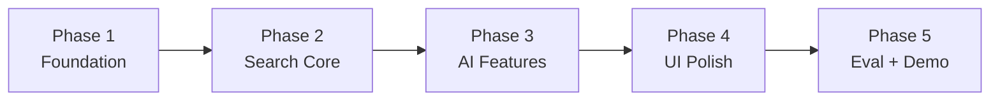
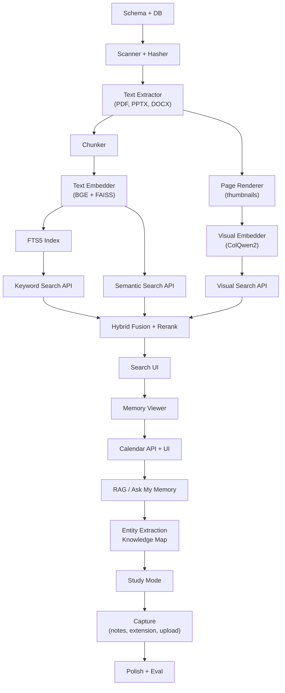

# Recall — Complete Build Roadmap

> **Status:** Phase 1 is in progress. The backend foundation, SQLite schema, folder mounting,
> source inventory, hashing, and incremental scanner are implemented; extraction, workers, retrieval,
> frontend, AI features, and evaluation remain.
> **Goal:** A working, demo-able final-year Deep Learning project.

---

## Project Summary (What We're Building)

**Recall** is a local-first, multimodal personal memory and knowledge system. It indexes your files (PDFs, slides, images, notes, docs) and lets you:
- **Search** by meaning, keywords, or visual appearance
- **Revisit** content through a memory calendar
- **Connect** knowledge via an AI-generated knowledge map
- **Ask questions** grounded in your own files (RAG)
- **Study** using auto-generated flashcards with spaced repetition

> [!IMPORTANT]
> **Stack:** Python + FastAPI backend · React + TypeScript + Tailwind frontend · SQLite + FAISS data layer · ColPali/BGE models for search

---

## Phased Execution Plan

The build is split into **5 phases** ordered by dependency and demo value. Each phase is independently demo-able.



---

## Phase 1 — Foundation & Ingestion Pipeline

**Output:** Files get indexed into SQLite + FAISS; backend API is running

### 1.1 — Project Scaffolding

**Directory structure to create:**
```
recall/
├── backend/
│   ├── app/
│   │   ├── main.py           ← FastAPI entry point
│   │   ├── config.py         ← settings from .env
│   │   ├── api/              ← route files
│   │   ├── ingestion/        ← pipeline modules
│   │   ├── retrieval/        ← search modules
│   │   ├── ai/               ← LLM/RAG wrappers
│   │   ├── calendar/         ← memory event queries
│   │   ├── db/               ← SQLite schema + queries
│   │   └── workers/          ← background indexing
│   ├── requirements.txt
│   └── .env.example
├── frontend/
│   ├── src/
│   │   ├── components/
│   │   ├── views/
│   │   └── lib/
│   ├── package.json
│   └── vite.config.ts
├── eval/
│   ├── queries.json
│   └── run_benchmark.py
└── README.md
```

**Setup commands:**
```bash
# Backend
cd backend
python -m venv .venv && source .venv/bin/activate
pip install fastapi uvicorn sqlalchemy aiosqlite \
    pymupdf python-pptx python-docx \
    sentence-transformers faiss-cpu \
    paddleocr pillow python-multipart \
    python-dotenv httpx pydantic-settings

# Frontend
cd frontend
npm create vite@latest . -- --template react-ts
npm install tailwindcss @tailwindcss/vite shadcn-ui \
    @tanstack/react-query axios react-router-dom \
    cmdk react-force-graph cytoscape lucide-react
```

**Key files to create:**
- `backend/app/config.py` — `DATA_DIR`, `LLM_PROVIDER`, `LLM_API_KEY`, `ALLOW_CLOUD_AI`, `VISUAL_MODEL`
- `backend/app/main.py` — FastAPI app with CORS, router mounts, lifespan events
- `backend/app/db/schema.py` — SQLite table definitions (see Section 1.2)

---

### 1.2 — Database Schema

**All tables to create:**

```sql
-- sources: every file/note/capture Recall knows about
CREATE TABLE sources (
    source_id    INTEGER PRIMARY KEY AUTOINCREMENT,
    source_type  TEXT NOT NULL,          -- pdf, pptx, docx, image, note, webpage, audio
    title        TEXT,
    original_path TEXT NOT NULL,
    mime_type    TEXT,
    content_hash TEXT,                   -- SHA-256 for change detection
    created_at   DATETIME,
    modified_at  DATETIME,
    imported_at  DATETIME DEFAULT CURRENT_TIMESTAMP,
    captured_at  DATETIME,
    indexing_status TEXT DEFAULT 'pending',  -- pending|processing|done|error
    excluded     BOOLEAN DEFAULT 0
);

-- document_units: pages, slides, chunks
CREATE TABLE document_units (
    unit_id              INTEGER PRIMARY KEY AUTOINCREMENT,
    source_id            INTEGER REFERENCES sources(source_id) ON DELETE CASCADE,
    unit_type            TEXT,           -- page, slide, chunk, segment
    page_or_slide        INTEGER,
    timestamp_sec        REAL,           -- for audio
    extracted_text       TEXT,
    text_embedding_ref   TEXT,           -- FAISS index id
    visual_embedding_ref TEXT
);

-- FTS5 virtual table for keyword search
CREATE VIRTUAL TABLE fts_units USING fts5(
    unit_id UNINDEXED,
    source_id UNINDEXED,
    extracted_text,
    tokenize='porter ascii'
);

-- memory_events: every import, capture, study session
CREATE TABLE memory_events (
    event_id   INTEGER PRIMARY KEY AUTOINCREMENT,
    event_type TEXT,                    -- imported, modified, captured, studied
    source_id  INTEGER REFERENCES sources(source_id) ON DELETE CASCADE,
    timestamp  DATETIME DEFAULT CURRENT_TIMESTAMP,
    date_basis TEXT                     -- created_at|modified_at|imported_at|captured_at|studied_at
);

-- objects: topics, people, projects (knowledge graph nodes)
CREATE TABLE objects (
    object_id   INTEGER PRIMARY KEY AUTOINCREMENT,
    object_type TEXT,                   -- topic, person, project, concept
    title       TEXT NOT NULL,
    description TEXT,
    provenance  TEXT                    -- source file(s) that mention this
);

-- relationships: knowledge graph edges
CREATE TABLE relationships (
    relationship_id  INTEGER PRIMARY KEY AUTOINCREMENT,
    from_object_id   INTEGER REFERENCES objects(object_id),
    to_object_id     INTEGER REFERENCES objects(object_id),
    relationship_type TEXT,
    confidence       REAL,
    created_by       TEXT,              -- llm|user
    reviewed_status  TEXT DEFAULT 'unreviewed'
);

-- study_sessions
CREATE TABLE study_sessions (
    session_id         INTEGER PRIMARY KEY AUTOINCREMENT,
    object_id          INTEGER REFERENCES objects(object_id),
    started_at         DATETIME,
    completed_at       DATETIME,
    questions_attempted INTEGER,
    answers_correct    INTEGER
);

-- flashcards (needed for study mode)
CREATE TABLE flashcards (
    card_id      INTEGER PRIMARY KEY AUTOINCREMENT,
    source_id    INTEGER REFERENCES sources(source_id),
    unit_id      INTEGER REFERENCES document_units(unit_id),
    card_type    TEXT,                  -- flashcard, mcq, short_answer
    front        TEXT,
    back         TEXT,
    options      TEXT,                  -- JSON array for MCQ
    next_review  DATETIME,
    ease_factor  REAL DEFAULT 2.5,     -- SM-2
    interval_days INTEGER DEFAULT 1
);
```

**Migration strategy:** `db/migrations.py` runs `CREATE TABLE IF NOT EXISTS` on startup — no Alembic needed.

---

### 1.3 — Ingestion Pipeline

**Flow:** `folder path` → `scanner` → `extractor` → `chunker` → `embedder` → `SQLite + FAISS`

#### `backend/app/ingestion/scanner.py`
- Walk directory recursively with `pathlib`
- Skip excluded folders/files
- For each file: compute `SHA-256` hash, compare with stored hash
- Enqueue only new/changed files
- Dispatch to `workers/indexing_worker.py`

#### `backend/app/ingestion/extractor.py`
Dispatch by MIME type:

| File Type | Library | What to Extract |
|---|---|---|
| `.pdf` | `PyMuPDF` (fitz) | Text per page, render page to PNG |
| `.pptx` | `python-pptx` | Text per slide, LibreOffice → PNG |
| `.docx` | `python-docx` | Paragraphs → chunks |
| `.jpg/.png` | `Pillow` | OCR the image, visual embed |
| `.txt/.md` | Built-in | Direct text |
| `.mp3/.wav` | `faster-whisper` | Transcribe → timestamped chunks |

```python
# Key pattern for PDF extraction
import fitz  # PyMuPDF
doc = fitz.open(path)
for page_num, page in enumerate(doc):
    text = page.get_text()
    pix = page.get_pixmap(dpi=150)
    img_path = save_thumbnail(pix, source_id, page_num)
    # Store text + image path in document_units
```

#### `backend/app/ingestion/ocr.py`
- Use PaddleOCR as primary (better accuracy)
- Tesseract as fallback
- Only OCR pages where `len(text) < 100` (mostly image pages)

#### `backend/app/ingestion/chunker.py`
- Split extracted text into ~400-token chunks with 50-token overlap
- Each chunk keeps its `source_id` and `page_or_slide` reference
- Use `tiktoken` or character-based splitting

#### `backend/app/ingestion/embedder.py`
- **Text embeddings:** `sentence-transformers` with `BAAI/bge-base-en-v1.5`
- **Visual embeddings:** ColQwen2 or SigLIP as fallback
- Write to two separate FAISS indices: text + visual
- Store FAISS IDs back in `document_units.text_embedding_ref`

```python
from sentence_transformers import SentenceTransformer
model = SentenceTransformer("BAAI/bge-base-en-v1.5")
embeddings = model.encode(chunks, batch_size=32, normalize_embeddings=True)
# Add to faiss.IndexFlatIP (inner product = cosine for normalized vecs)
```

#### `backend/app/workers/indexing_worker.py`
- Use `asyncio` + `concurrent.futures.ProcessPoolExecutor` for CPU-heavy work
- Track `indexing_status` in `sources` table
- Expose progress via `GET /index/status`

---

### 1.4 — Core API Routes

**File:** `backend/app/api/sources.py`
```
POST /sources/folders     → mount a folder, trigger scan
DELETE /sources/{id}      → remove source + cascade delete derived data
GET /sources              → list all sources with status
GET /index/status         → { total, done, processing, errors }
POST /index/pause         → pause background worker
POST /index/resume        → resume background worker
```

**File:** `backend/app/api/units.py`
```
GET /units/{id}           → page/slide/chunk with source info + thumbnail path
```

**File:** `backend/app/api/capture.py`
```
POST /capture             → accept note, URL, or file upload → process like a source
```

> [!NOTE]
> At the end of Phase 1, you should be able to: add a folder via `curl`, watch it get indexed in the background, and query the SQLite database to see chunks and their embeddings.

---

## Phase 2 — Search Core

**Output:** A working search UI with keyword + semantic + visual + hybrid results

### 2.1 — Keyword Search

**File:** `backend/app/retrieval/fts_search.py`

```python
# FTS5 BM25 search
cursor.execute("""
    SELECT unit_id, source_id, snippet(fts_units, 2, '<b>', '</b>', '...', 10) as snip,
           bm25(fts_units) as score
    FROM fts_units
    WHERE fts_units MATCH ?
    ORDER BY score
    LIMIT 50
""", (query,))
```

- Support phrase queries (wrap in `"..."`)
- Support field filters: `source_type`, `imported_at` date range
- Return `unit_id`, `source_id`, `page`, `snippet`, `score`

---

### 2.2 — Semantic Search

**File:** `backend/app/retrieval/semantic_search.py`

```python
import faiss, numpy as np
from sentence_transformers import SentenceTransformer

model = SentenceTransformer("BAAI/bge-base-en-v1.5")

def semantic_search(query: str, top_k: int = 50):
    q_emb = model.encode([query], normalize_embeddings=True)
    scores, ids = text_faiss_index.search(q_emb, top_k)
    return [(unit_id_map[i], float(s)) for i, s in zip(ids[0], scores[0])]
```

- Keep a `faiss_id_to_unit_id` JSON mapping on disk
- Persist the FAISS index to `{DATA_DIR}/text_index.faiss`
- Reload on startup

---

### 2.3 — Visual Search

**File:** `backend/app/retrieval/visual_search.py`

This is the **Deep Learning core** of the project — the differentiator.

**Strategy:**
1. **Primary:** ColQwen2 (from `colpali-engine` library) — multi-vector per page
2. **Fallback:** SigLIP or CLIP (single-vector) for low-VRAM machines

```python
# ColPali visual search pattern
from colpali_engine.models import ColQwen2, ColQwen2Processor

model = ColQwen2.from_pretrained("vidore/colqwen2-v1.0")
processor = ColQwen2Processor.from_pretrained("vidore/colqwen2-v1.0")

# At indexing time: encode page image → store pooled vector in FAISS
# At query time: encode text query → MaxSim score against stored vectors
```

**Visual FAISS index:** separate from text index, keyed by `unit_id`

> [!TIP]
> Use pooled (mean) vectors in FAISS for fast ~50 candidate retrieval, then rescore top candidates with full MaxSim for accuracy.

---

### 2.4 — Hybrid Fusion + Reranking

**File:** `backend/app/retrieval/fusion.py`

Reciprocal Rank Fusion (RRF):
```python
def rrf(ranked_lists: list[list[tuple]], k: int = 60) -> list[tuple]:
    scores = {}
    for ranked in ranked_lists:
        for rank, (unit_id, _) in enumerate(ranked):
            scores[unit_id] = scores.get(unit_id, 0) + 1 / (k + rank + 1)
    return sorted(scores.items(), key=lambda x: x[1], reverse=True)
```

**File:** `backend/app/retrieval/reranker.py`
- Use `cross-encoder/ms-marco-MiniLM-L-6-v2` from `sentence-transformers`
- Rerank top 20 from RRF output
- Return top 10 final results

---

### 2.5 — Search API + Frontend

**Backend:** `backend/app/api/search.py`
```
GET /search?q=...&type=pdf&from_date=2025-01-01&to_date=2025-12-31&mode=hybrid
```
Returns:
```json
{
  "results": [
    {
      "unit_id": 42,
      "source_id": 7,
      "title": "Transformers Paper.pdf",
      "page": 4,
      "snippet": "...attention is all you need...",
      "thumbnail_url": "/thumbnails/7/page_4.png",
      "match_type": ["semantic", "keyword"],
      "score": 0.87
    }
  ],
  "total": 23,
  "query_ms": 142
}
```

**Frontend:** `frontend/src/views/SearchView.tsx`
- Global search bar always visible (top)
- `Ctrl+K` → `cmdk` command palette
- Results grid with thumbnails, page numbers, match reason chips
- Filter sidebar: file type, date range, folder
- Click result → open `MemoryViewer` with that page highlighted

**Frontend:** `frontend/src/views/MemoryViewer.tsx`
- Shows the full document with selected page highlighted
- Sidebar: metadata (imported date, modified date, folder), related items

> [!NOTE]
> At the end of Phase 2, you have a **fully functional search system** — this alone is demo-worthy. Keyword + semantic + visual search + reranking, all in a UI.

---

## Phase 3 — AI Features (Ask, Knowledge Map, Study)

**Output:** Working RAG chat, graph view, and study mode

### 3.1 — LLM Provider Layer

**File:** `backend/app/ai/provider.py`

Unified interface so we can swap providers:
```python
class LLMProvider(Protocol):
    async def complete(self, messages: list[dict], **kwargs) -> str: ...

class AnthropicProvider:
    async def complete(self, messages, **kwargs):
        # Use anthropic.AsyncAnthropic()
        ...

class OpenAIProvider:
    async def complete(self, messages, **kwargs):
        # Use openai.AsyncOpenAI()
        ...

class OllamaProvider:
    async def complete(self, messages, **kwargs):
        # POST http://localhost:11434/api/chat
        ...
```

Controlled by `LLM_PROVIDER` env var. Never send anything to cloud if `ALLOW_CLOUD_AI=false`.

---

### 3.2 — Ask My Memory (RAG)

**File:** `backend/app/ai/rag.py`

Pipeline:
1. Run hybrid search on the question (top 10 chunks)
2. Check evidence threshold: if max score < 0.4 → return "not enough evidence"
3. Build prompt with numbered source citations
4. Stream LLM response
5. Return answer + citations (source_id, page, title, snippet)

```python
SYSTEM_PROMPT = """You are a personal knowledge assistant.
Answer ONLY from the provided sources.
Cite every claim as [1], [2], etc.
If the sources don't contain the answer, say:
"I don't have enough information in your files to answer this."
Never make up information."""
```

**API:** `POST /ask`
```json
{
  "question": "What did I save about transformers?",
  "chat_history": []
}
```
Returns:
```json
{
  "answer": "Based on your files, transformers use self-attention [1][2]...",
  "citations": [
    {"ref": 1, "source_id": 7, "title": "Attention Paper.pdf", "page": 3, "snippet": "..."}
  ],
  "confidence": "high"
}
```

**Frontend:** `frontend/src/views/AskView.tsx`
- Chat interface with message history
- Inline citation chips (click → open source page)
- "Not enough evidence" banner when triggered
- Disclaimer: "Answers come only from your indexed files"

---

### 3.3 — Knowledge Map

**File:** `backend/app/ai/entity_extraction.py`

For each document, prompt the LLM:
```python
EXTRACTION_PROMPT = """
Extract from this text:
- Topics/concepts (key ideas)
- People (names mentioned)
- Projects (named projects or papers)

Return as JSON: {"topics": [...], "people": [...], "projects": [...]}
"""
```

Fallback: use `spaCy` NER + `KeyBERT` for keyword extraction (no LLM needed).

**Deduplication:** embed all extracted titles → merge those with cosine similarity > 0.9

**Storage:** insert into `objects` table, create `relationships` from co-occurrence + LLM-extracted links

**API:** `GET /graph` → returns nodes + edges in Cytoscape format:
```json
{
  "nodes": [{"id": "1", "label": "Transformers", "type": "topic"}],
  "edges": [{"source": "1", "target": "2", "label": "related_to", "confidence": 0.8}]
}
```

**Frontend:** `frontend/src/views/KnowledgeMapView.tsx`
- Use `react-force-graph` for interactive graph
- Node colors by type (topic/person/project)
- Click node → sidebar shows evidence sources
- Edge labels show relationship type + confidence
- Edit/confirm/delete buttons on edges

---

### 3.4 — Study Mode

**File:** `backend/app/ai/study_generator.py`

```python
STUDY_PROMPT = """
Based on this content, generate study material:
1. 3-5 flashcards (front: question, back: answer)
2. 2-3 MCQs with 4 options and explanations
3. 1-2 short-answer questions

Return as JSON with source references (page numbers).
"""
```

**SM-2 Spaced Repetition:**
```python
def sm2_next_review(ease_factor, interval, quality):
    # quality: 0-5 (0=blackout, 5=perfect)
    if quality < 3:
        interval = 1
    elif interval == 1:
        interval = 6
    else:
        interval = round(interval * ease_factor)
    ease_factor = max(1.3, ease_factor + 0.1 - (5 - quality) * (0.08 + (5 - quality) * 0.02))
    return interval, ease_factor
```

**APIs:**
```
POST /study/generate    → generate cards for a source or topic
GET /study/due          → cards due for review today
POST /study/respond     → submit answer quality, update SM-2 schedule
POST /study/sessions    → record completed session → creates memory_event (studied_at)
```

**Frontend:** `frontend/src/views/StudyView.tsx`
- Card flip animation (front/back)
- MCQ with option selection + explanation reveal
- Progress bar (cards done / total due)
- After session: show score, weak areas, next review date

---

## Phase 4 — Memory Calendar & UI Polish

**Output:** Complete, polished 3-panel UI with all features connected

### 4.1 — Memory Calendar

**File:** `backend/app/calendar/events.py`

```
GET /calendar?view=month&date=2025-11
```
Returns events grouped by day:
```json
{
  "2025-11-15": [
    {"event_type": "imported", "title": "ML Paper.pdf", "date_basis": "imported_at"},
    {"event_type": "studied", "title": "Transformers flashcards", "date_basis": "studied_at"}
  ]
}
```

**Special queries:**
- `GET /calendar/on-this-day` → today's date, all past years
- `GET /calendar/recap?period=week&date=2025-11-10` → weekly/monthly summary

**Frontend:** `frontend/src/views/CalendarView.tsx`
- Month/Week/Day view tabs
- Day cells show colored dots for event types
- Click day → panel slides open with that day's memories
- "Memory Wall" view: mosaic of thumbnails by date
- "On This Day" banner on Home view
- **Every calendar card shows the `date_basis` label** e.g., *"Imported on Nov 15"*

---

### 4.2 — Three-Panel Layout + Navigation

**File:** `frontend/src/components/Layout.tsx`

```
+------------------+----------------------------------+-------------------+
| LEFT SIDEBAR     | MAIN CONTENT AREA                | RIGHT PANEL       |
|                  |                                  |                   |
| [Search bar]     | <SearchView />                   | Mini calendar     |
| Home             | <CalendarView />                 | Related items     |
| Search           | <AskView />                      | Metadata          |
| Calendar         | <KnowledgeMapView />             | Recently revisited|
| Knowledge Map    | <StudyView />                    |                   |
| Ask My Memory    | <MemoryViewer />                 |                   |
| Study Mode       |                                  |                   |
| Pinned           |                                  |                   |
| [Object counts]  |                                  |                   |
+------------------+----------------------------------+-------------------+
```

**Key components:**
- `frontend/src/components/CommandPalette.tsx` — `cmdk` powered `Ctrl+K` palette
- `frontend/src/components/IndexingStatus.tsx` — progress bar in sidebar with pause/resume
- `frontend/src/components/ThumbnailCard.tsx` — reusable search result card
- `frontend/src/components/SourceViewer.tsx` — PDF/image viewer with page navigation

---

### 4.3 — Capture Features

**Notes:** `TipTap` markdown editor in `CaptureView.tsx` → `POST /capture` with `type=note`

**Drag & Drop:** `react-dropzone` on the main area → uploads to `POST /capture` with file

**Browser Extension:** `extension/manifest.json` (Manifest V3)
- Content script captures `document.title` + `document.body.innerText`
- Sends `POST http://localhost:8000/capture` with `type=webpage`
- Popup shows "Saved to Recall ✓"

---

### 4.4 — Themes & Polish

- Light/dark theme toggle with `tailwindcss` dark mode
- Responsive sidebar collapse on smaller screens
- Loading skeletons for search results
- Empty states for each view (no results, no sources yet)
- Error boundaries with helpful messages
- Indexing status badge on each source in sidebar
- Keyboard shortcuts documented in `Ctrl+K` palette

---

## Phase 5 — Evaluation & Demo Prep

**Output:** Benchmark results, polished demo, submission-ready

### 5.1 — Build Evaluation Dataset

**File:** `eval/queries.json`
```json
[
  {
    "query": "Find the diagram explaining self-attention mechanism",
    "type": "visual",
    "relevant_pages": [{"source": "attention_paper.pdf", "page": 3}]
  },
  {
    "query": "What is the vanishing gradient problem?",
    "type": "semantic",
    "relevant_pages": [{"source": "dl_notes.pdf", "page": 12}]
  },
  {
    "query": "LSTM cell equations",
    "type": "keyword",
    "relevant_pages": [{"source": "rnn_slides.pptx", "slide": 7}]
  }
]
```

Build a fixed corpus of 20–30 documents (your actual lecture PDFs, papers, notes). Write 50+ queries covering keyword, semantic, and visual types.

---

### 5.2 — Run Benchmark

**File:** `eval/run_benchmark.py`

```python
# For each query, run all 5 retrieval modes:
modes = ["keyword", "semantic", "visual", "hybrid", "hybrid_rerank"]

for mode in modes:
    results = run_search(query, mode=mode)
    # Compute Recall@5, Precision@5, MRR, NDCG@10
    metrics = evaluate(results, relevant_pages)
```

**Target metrics to show in report:**
- Hybrid+Rerank should outperform each individual mode
- Visual search should catch diagram queries that text search misses

---

### 5.3 — Demo Script

**5-minute demo flow:**

1. **Open app** → show empty state → "Add Folder" with your lecture PDFs
2. **Watch indexing** → sidebar progress bar fills up
3. **Search demo:** type "attention mechanism diagram" → show visual results with thumbnails
4. **Calendar demo:** navigate to a past date → "On This Day" memory
5. **Ask My Memory:** ask "What is the difference between LSTM and GRU?" → show cited answer
6. **Knowledge Map:** show topic graph, click "Transformers" node → evidence sources
7. **Study Mode:** generate flashcards from a document, flip through 3 cards
8. **Capture:** drag a screenshot into the app → it appears in search immediately

---

## Technical Decisions & Rationale

| Decision | Choice | Reason |
|---|---|---|
| Embedding model | `BAAI/bge-base-en-v1.5` | Best open-source text embedder; runs on CPU |
| Visual model | ColQwen2 → SigLIP fallback | SOTA document visual retrieval; fallback for no GPU |
| Vector DB | FAISS (flat index) | No server needed; sufficient for <1M chunks |
| DB | SQLite + FTS5 | Zero infrastructure; FTS5 BM25 is excellent |
| Frontend | React + Vite + Tailwind | Fast dev; shadcn/ui for components |
| Reranker | `cross-encoder/ms-marco-MiniLM-L-6-v2` | Accurate; CPU-friendly |
| Desktop shell | Tauri (deferred to end) | First ship as local web app |

---

## Critical Implementation Order



---

## Task Checklist

### Phase 1 — Foundation
- [ ] Create project directory structure (backend + frontend)
- [ ] Set up Python venv + install all dependencies
- [ ] Create Vite React TypeScript project
- [x] Write `config.py` with `.env` loading
- [x] Write database schema (`schema.py`) with all tables
- [x] Write database initialization on startup
- [x] Write `main.py` with FastAPI + CORS + router mounts
- [x] Write scanner — walk folder, hash files, detect changes
- [ ] Write `extractor.py` — PDF (PyMuPDF), PPTX, DOCX, Image, TXT
- [ ] Write `ocr.py` — PaddleOCR integration
- [ ] Write `chunker.py` — text splitting with page reference
- [ ] Write `embedder.py` — BGE model + FAISS text index
- [ ] Write `indexing_worker.py` — background async worker
- [ ] Write `api/sources.py` — folder mount/remove/list endpoints
- [ ] Write `api/status.py` — indexing progress endpoint
- [ ] Write `api/capture.py` — note/upload endpoint
- [ ] Write `api/units.py` — unit retrieval endpoint
- [ ] **Test:** add folder via API → watch indexing → verify chunks in SQLite + FAISS

### Phase 2 — Search Core
- [ ] Write `retrieval/fts_search.py` — FTS5 BM25 keyword search
- [ ] Write `retrieval/semantic_search.py` — FAISS semantic search
- [ ] Write `retrieval/visual_search.py` — ColQwen2 visual embedder
- [ ] Add page image embedding to visual FAISS index during ingestion
- [ ] Write `retrieval/fusion.py` — Reciprocal Rank Fusion
- [ ] Write `retrieval/reranker.py` — cross-encoder reranking
- [ ] Expose `GET /search` with modes: `keyword`, `semantic`, `visual`, `hybrid`, `hybrid_rerank`
- [ ] Build `SearchView.tsx` — search bar, results grid, filters
- [ ] Build `ThumbnailCard.tsx` — card with image, snippet, page, match reason
- [ ] Build `MemoryViewer.tsx` — document view with page navigation
- [ ] Connect frontend search to backend `GET /search`
- [ ] **Test:** verify hybrid outperforms individual modes on test queries

### Phase 3 — AI Features
- [ ] Write `ai/provider.py` — Anthropic/OpenAI/Ollama unified interface
- [ ] Write `ai/rag.py` — retrieval-augmented generation
- [ ] Expose `POST /ask` endpoint
- [ ] Build `AskView.tsx` — chat interface with citation chips
- [ ] Write `ai/entity_extraction.py` — LLM or spaCy NER extraction
- [ ] Run extraction on indexed documents → populate `objects` table
- [ ] Expose `GET /graph` endpoint
- [ ] Build `KnowledgeMapView.tsx` — react-force-graph visualization
- [ ] Add node click → evidence sidebar + edge edit/confirm/delete controls
- [ ] Write `ai/study_generator.py` — card generation prompt
- [ ] Write SM-2 scheduling logic
- [ ] Expose `/study/generate`, `/study/due`, `/study/respond`, `/study/sessions`
- [ ] Build `StudyView.tsx` — card flip, MCQ, progress bar

### Phase 4 — UI Polish
- [ ] Write `calendar/events.py` — event queries grouped by day
- [ ] Expose `GET /calendar`, `GET /calendar/on-this-day`
- [ ] Build `CalendarView.tsx` — month/week/day views with colored dots
- [ ] Build "Memory Wall" mosaic view
- [ ] Build 3-panel `Layout.tsx` with left nav + right panel
- [ ] Build `CommandPalette.tsx` with `cmdk` (Ctrl+K)
- [ ] Build `IndexingStatus.tsx` — progress + pause/resume
- [ ] Build `CaptureView.tsx` — TipTap note editor + drag-drop
- [ ] Write browser extension manifest + content script
- [ ] Light/dark theme
- [ ] Loading skeletons, empty states, error boundaries
- [ ] Keyboard navigation through results
- [ ] Connect all views: "open in calendar", "study this", "find related"
- [ ] **End-to-end smoke test:** add folder → index → search → ask → study

### Phase 5 — Evaluation & Demo
- [ ] Build `eval/queries.json` with 50+ labelled queries
- [ ] Write `eval/run_benchmark.py`
- [ ] Run evaluation on all 5 retrieval modes
- [ ] Fill in results table in README
- [ ] Write evaluation section of project report
- [ ] Bug fixes from E2E testing
- [ ] Record or run live demo
- [ ] Write project report / presentation slides
- [ ] (Optional) Package with Tauri for desktop app

---

## Risk Mitigation

| Risk | Mitigation |
|---|---|
| ColQwen2 too heavy (no GPU) | Use SigLIP single-vector fallback; still demonstrates visual search |
| LLM API costs | Use Ollama with `llama3.2` for all LLM features locally |
| OCR accuracy poor | PaddleOCR > Tesseract; skip OCR for already-text-rich PDFs |
| FAISS index rebuild takes too long | Incremental updates; only re-embed changed files |
| Browser extension blocked | Test in Chrome dev mode; it's optional for demo |
| LibreOffice headless not available | Render PPTX slides with `python-pptx` + Pillow as fallback |

---

## Minimum Viable Demo (If Time is Ultra-Short)

If you must cut, deliver **in this priority order:**

1. ✅ Folder scanning + PDF/image indexing
2. ✅ Keyword + semantic search with thumbnails
3. ✅ Visual search (even with SigLIP fallback)
4. ✅ Hybrid fusion + reranking
5. ✅ Search UI with result viewer
6. ✅ Evaluation benchmark results
7. 🔵 Ask My Memory (RAG)
8. 🔵 Memory Calendar
9. 🟡 Knowledge Map
10. 🟡 Study Mode
11. ⚪ Browser extension
12. ⚪ Tauri packaging

> [!CAUTION]
> Items 1–6 are **the deep learning core** of this project (retrieval + embeddings + visual models). These must be done and evaluated. Items 7+ are product features.

---

## Key Dependencies

```bash
# Backend
pip install fastapi uvicorn[standard] python-dotenv pydantic-settings \
    sqlalchemy aiosqlite \
    pymupdf python-pptx python-docx \
    sentence-transformers faiss-cpu \
    paddlepaddle paddleocr \
    pillow python-multipart httpx \
    colpali-engine \
    faster-whisper \
    spacy keybert \
    anthropic openai \
    tiktoken

# Download spaCy model
python -m spacy download en_core_web_sm

# Frontend
npm install @tanstack/react-query axios react-router-dom \
    cmdk react-force-graph cytoscape \
    @tiptap/react @tiptap/starter-kit \
    react-dropzone lucide-react \
    clsx tailwind-merge
```

---

## Files to Create (Master List)

### Backend
| File | Purpose |
|---|---|
| `backend/app/main.py` | FastAPI app, lifespan, CORS |
| `backend/app/config.py` | Settings from .env |
| `backend/app/db/schema.py` | Table CREATE statements |
| `backend/app/db/queries.py` | Reusable DB query functions |
| `backend/app/ingestion/scanner.py` | Folder walker + hash checker |
| `backend/app/ingestion/extractor.py` | PDF/PPTX/DOCX/Image extractors |
| `backend/app/ingestion/ocr.py` | PaddleOCR wrapper |
| `backend/app/ingestion/chunker.py` | Text splitter with page refs |
| `backend/app/ingestion/embedder.py` | BGE + ColQwen2 embedders |
| `backend/app/workers/indexing_worker.py` | Async background worker |
| `backend/app/retrieval/fts_search.py` | FTS5 BM25 keyword search |
| `backend/app/retrieval/semantic_search.py` | FAISS semantic search |
| `backend/app/retrieval/visual_search.py` | ColQwen2/SigLIP visual search |
| `backend/app/retrieval/fusion.py` | Reciprocal Rank Fusion |
| `backend/app/retrieval/reranker.py` | Cross-encoder reranker |
| `backend/app/ai/provider.py` | Unified LLM provider interface |
| `backend/app/ai/rag.py` | RAG pipeline for Ask My Memory |
| `backend/app/ai/entity_extraction.py` | LLM/spaCy entity extractor |
| `backend/app/ai/study_generator.py` | Flashcard/MCQ generator |
| `backend/app/calendar/events.py` | Memory event queries |
| `backend/app/api/sources.py` | Folder mount/remove endpoints |
| `backend/app/api/search.py` | Search endpoint |
| `backend/app/api/units.py` | Unit retrieval endpoint |
| `backend/app/api/ask.py` | RAG Q&A endpoint |
| `backend/app/api/graph.py` | Knowledge graph endpoint |
| `backend/app/api/study.py` | Study mode endpoints |
| `backend/app/api/calendar.py` | Calendar endpoints |
| `backend/app/api/capture.py` | Note/upload capture endpoint |

### Frontend
| File | Purpose |
|---|---|
| `frontend/src/lib/api.ts` | Axios API client with typed endpoints |
| `frontend/src/lib/store.ts` | Global state (React Query or Zustand) |
| `frontend/src/components/Layout.tsx` | 3-panel shell |
| `frontend/src/components/Sidebar.tsx` | Left navigation |
| `frontend/src/components/CommandPalette.tsx` | Ctrl+K cmdk palette |
| `frontend/src/components/IndexingStatus.tsx` | Progress + pause/resume |
| `frontend/src/components/ThumbnailCard.tsx` | Search result card |
| `frontend/src/components/SourceViewer.tsx` | Document viewer |
| `frontend/src/views/HomeView.tsx` | Home + On This Day |
| `frontend/src/views/SearchView.tsx` | Search + filters + results |
| `frontend/src/views/MemoryViewer.tsx` | Full document viewer |
| `frontend/src/views/CalendarView.tsx` | Month/week/day calendar |
| `frontend/src/views/AskView.tsx` | RAG chat interface |
| `frontend/src/views/KnowledgeMapView.tsx` | Force graph |
| `frontend/src/views/StudyView.tsx` | Flashcard study interface |
| `frontend/src/views/CaptureView.tsx` | Note editor + drag-drop |

### Extension
| File | Purpose |
|---|---|
| `extension/manifest.json` | MV3 manifest |
| `extension/content.js` | Page capture script |
| `extension/popup.html` | Popup UI |
| `extension/popup.js` | Send to Recall API |

### Eval
| File | Purpose |
|---|---|
| `eval/queries.json` | Labelled benchmark queries |
| `eval/run_benchmark.py` | Compute Recall@5, MRR, NDCG@10 |

---

*Built as a final-year Deep Learning course project. Working name: Recall.*
